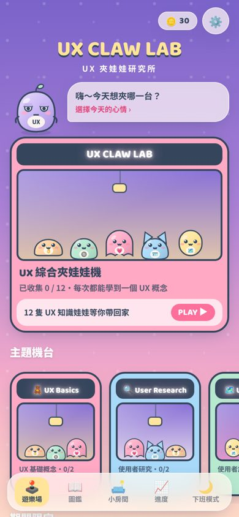
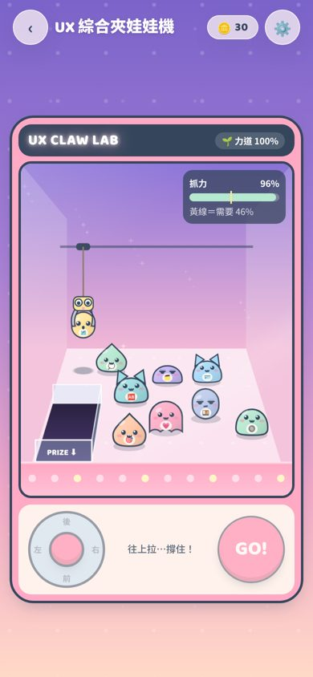
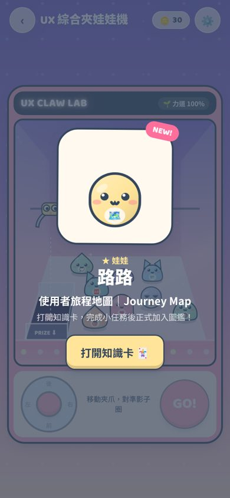
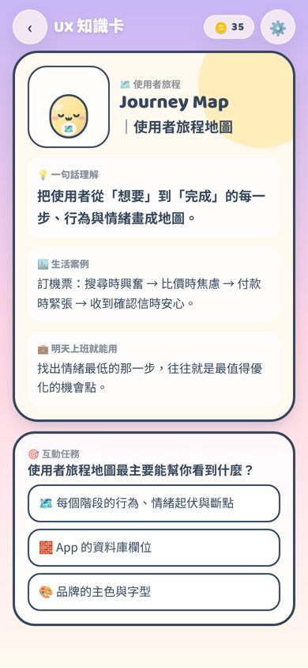
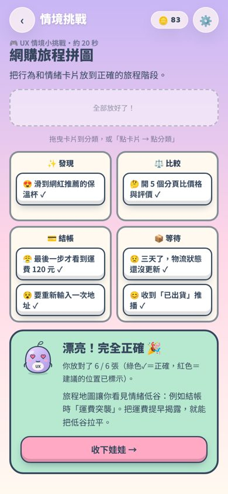
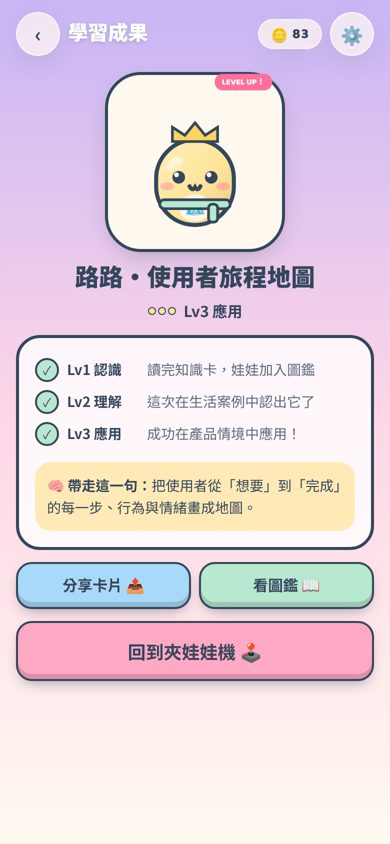
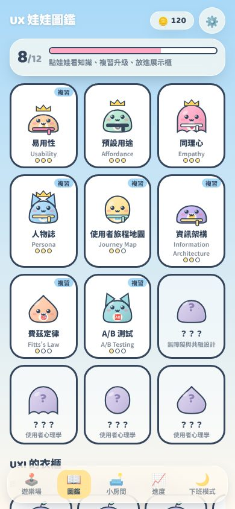
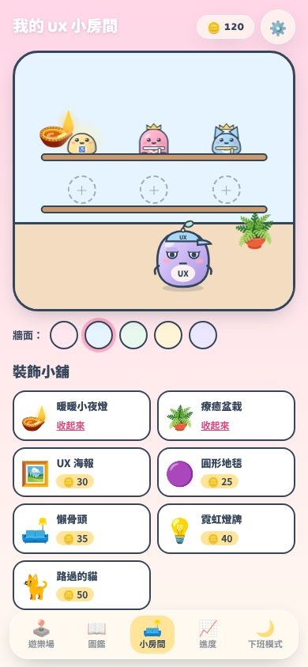
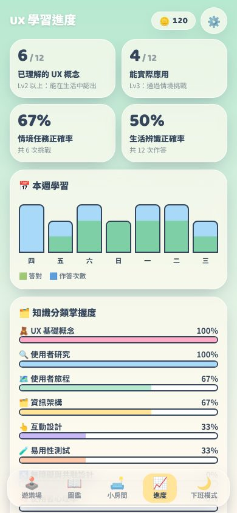
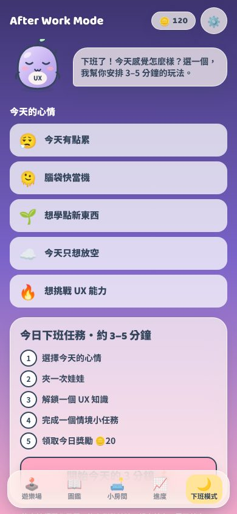

# 🕹️ UX CLAW LAB｜UX 夾娃娃研究所

> 「本來只是想夾個娃娃，結果不知不覺學會了 UX。」

一款 Mobile First 的網頁遊戲 MVP：用**真的有物理判定的夾娃娃機**夾回 12 隻 UX 知識娃娃，每隻娃娃都附帶一張互動知識卡與一個 15–30 秒的 UX 情境挑戰。收藏、升級、裝飾小房間，下班 3–5 分鐘輕鬆玩。

| 遊樂場 | 夾娃娃機 | 獲得娃娃 | 知識卡 | 情境挑戰 |
| --- | --- | --- | --- | --- |
|  |  |  |  |  |

| 學習成果 | 圖鑑 | 小房間 | 學習進度 | 下班模式 |
| --- | --- | --- | --- | --- |
|  |  |  |  |  |

---

## 快速開始

```bash
cd ux-claw-lab
npm install
npm run dev        # http://localhost:5173 （手機同網段可直接開 Network 網址）
npm test           # 夾娃娃物理引擎單元測試
npm run build      # 產出 dist/（純靜態，可部署到任何靜態主機）
```

需求：Node.js 18+。

### 怎麼玩

| 操作 | 手機 | 桌機 |
| --- | --- | --- |
| 移動夾爪（左右＝位置、上下＝深度） | 拖曳左下搖桿 | 方向鍵 / WASD |
| 放下夾爪 | 按 **GO!** | 空白鍵 / Enter |

看地上的**影子圈**——那就是夾爪真正會落下的位置。對準娃娃中心再按 GO!

### Demo 資料

右上角 ⚙️ 設定 → **載入 Demo**：一鍵載入 8 隻不同等級的娃娃、一週學習紀錄、需要複習的項目與品牌數據；**重設所有進度** 可回到全新狀態。所有進度存在瀏覽器 LocalStorage（key：`ux-claw-lab-v1`）。

---

## MVP 完成度

| 優先級 | 項目 | 狀態 |
| --- | --- | --- |
| P0 | 遊戲首頁（遊樂場 + 10 台主題機台） | ✅ |
| P0 | 完整可玩的 UX 夾娃娃機（綜合機 + 8 台有娃娃的主題機） | ✅ |
| P0 | 夾取物理互動：慣性、擺盪、碰撞推擠、抓力判定、滑落、掉落出口 | ✅ |
| P0 | UX 知識卡（一句話、生活案例、明天上班就能用、互動任務） | ✅ |
| P0 | UX 情境挑戰：12 個，7 種互動機制 | ✅ |
| P0 | 12 個知識娃娃（6 種造型、3 種稀有度、3 個等級外觀） | ✅ |
| P0 | 娃娃收藏圖鑑 + 本機進度保存 | ✅ |
| P1 | UXI 吉祥物（6 種表情、5 套造型，依學習成就解鎖） | ✅ |
| P1 | 下班心情系統（5 種心情 → 不同玩法參數） | ✅ |
| P1 | 每日任務（無連續登入懲罰） | ✅ |
| P1 | 房間裝飾、展示櫃、牆面顏色、裝飾小舖 | ✅ |
| P1 | 合成音效（Web Audio）+ 震動回饋（Vibration API） | ✅ |
| P1 | 學習進度儀表板 + 間隔複習 | ✅ |
| P1 | 音量、震動、減少動態效果設定 | ✅ |
| P2 | 品牌主題機台（標示贊助）+ 自願領取優惠券 + 核銷 | ✅ 示範版 |
| P2 | 品牌活動後台（曝光→遊玩→完成→領券→核銷 漏斗） | ✅ 示範版（本機資料） |
| P2 | 會員登入與雲端同步 | ⏳ 後續擴充 |

---

## 技術架構

| 項目 | 選擇 | 說明 |
| --- | --- | --- |
| 框架 | React 18 + TypeScript + Vite | |
| 樣式 | Tailwind CSS 3 | 設計 token 定義於 `tailwind.config.js` |
| 動畫 | Framer Motion | 按鈕彈性、頁面轉場、獲得動畫；尊重「減少動態效果」 |
| 狀態 | Zustand + `persist` | LocalStorage 保存進度 |
| 遊戲引擎 | **自製 2.5D 物理引擎 + Canvas 2D** | 見下方說明 |

**為什麼不用 Phaser？** 夾娃娃機需要的是「2.5D 深度（前後移動）＋ 擺盪 ＋ 抓力規則」，自製的純 TypeScript 引擎約 500 行即可完成，且：①可以在 Node 中單元測試、②規則完全透明可解釋（公平性需求）、③bundle 只有 135 KB gzip。若未來需要大量關卡/粒子，可以把 `render.ts` 換成 Phaser/Pixi，`physics.ts` 不用動。

```
src/
├── game/
│   ├── physics.ts        # ClawEngine：純 TS 物理與判定（可測試，無 DOM）
│   ├── physics.test.ts   # 對準→贏、空夾→輸、偏移→滑落、決定性
│   ├── render.ts         # Canvas 透視投影、陰影、夾爪、機台
│   └── drawDoll.ts       # 娃娃程序化繪製（機台與 UI 共用同一份程式）
├── data/                 # 10 個主題、12 隻娃娃與全部學習內容
├── challenges/           # 7 種互動挑戰元件
├── screens/              # Loading / Home / Machine / Learn / Collection / Room / Progress / Daily / Settings / Brand
├── components/           # UXI 吉祥物、DollAvatar、按鈕、底部導覽、Sheet、Toast
├── store/useGame.ts      # 遊戲狀態、等級計算、間隔複習
└── lib/                  # 音效、心情設定、分享卡片
```

### 夾取規則（公開、可解釋、無隱藏機率）

```
對準度 alignment = 1 − (影子圈中心到娃娃中心的距離 ÷ (娃娃半徑 + 8))
抓力   grip      = alignment × 夾爪力道(心情) + 暖心加成(連續失手，每次 +8%，最多 +24%，畫面上會顯示)
需求   need      = 娃娃重量(一般 1.0 / 稀有 1.18 / 傳說 1.32) × 0.40 + 擺盪壓力 + 起吊瞬間 +0.05
```

* 收爪時 `grip < need × 0.75` → 夾爪只碰到邊緣，娃娃被推開（**miss: weak**）。
* 上升與運送時每一幀檢查 `grip < need` → 娃娃滑落（**miss: slip**），掉下的娃娃仍可能剛好掉進出口。
* 夾爪下降時，爪子邊緣碰到偏離中心的娃娃會把它推開（碰撞）。
* 娃娃完全依物理落點判定：掉進 PRIZE 出口才算贏。
* 抓力條與需求線在畫面上即時顯示；失敗時會告訴玩家具體原因與下一步。

### 開發者工具

網址加上 `?debug` 會把 `window.__claw`（引擎）與 `window.__game`（store）暴露出來，方便自動化測試與 QA。

---

更多產品設計細節（資訊架構、遊戲流程、視覺系統、角色設計、學習設計、A/B 測試方案、商業模式與後續擴充建議）請見 **[docs/PRODUCT.md](docs/PRODUCT.md)**。
