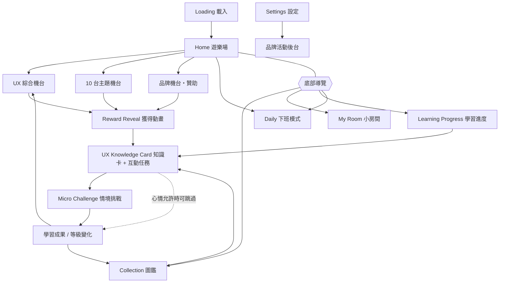
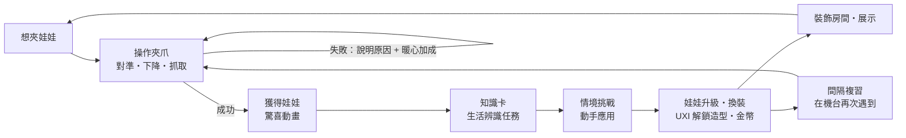

# UX CLAW LAB｜產品設計文件

> 產品核心理念：**把 UX 知識變成想抓到的寶物，讓每一次遊玩都成為一次有趣的學習。**

---

## 1. 產品資訊架構

| 頁面 | 目的 | 主要元件 |
| --- | --- | --- |
| Loading | 建立世界觀與期待 | 夾爪把 UXI 吊下來、品牌標誌、療癒小語 |
| Home | 選擇想玩的機台 | UXI 對話泡泡（依心情/時段）、待複習提示、主機台、主題機台橫向列表、期間限定贊助機台 |
| Claw Machine | 核心玩法 | Canvas 機台、搖桿、GO! 按鈕、抓力條、規則說明、失敗原因回饋 |
| Reward Reveal | 獲得的驚喜 | 彈跳登場、NEW! 標籤、稀有度光芒與粒子、音效、震動 |
| Knowledge Card | 1 分鐘理解概念 | 一句話理解、生活案例、明天上班就能用、互動任務 |
| Micro Challenge | 動手應用 | 7 種操作型挑戰，送出後立即顯示正誤原因 |
| Collection | 收集成就感 | 12 格圖鑑（未收集為剪影）、等級、複習、展示櫃、分享、UXI 衣櫃 |
| My Room | 個人化與展示 | 6 格展示櫃、裝飾小舖、牆面顏色、優惠券夾 |
| Learning Progress | 驗證學習成效 | KPI、本週學習、分類掌握度、需要複習、已具備技能 |
| Daily Mission | 下班 3–5 分鐘儀式 | 5 種心情、5 步任務、每日獎勵 |

## 2. 核心遊戲循環

**收藏 ↔ 學習的正向循環**：娃娃的外觀（圍巾、皇冠）與 UXI 的衣服只能靠「真的學會」解鎖——想要更可愛的收藏，就得更懂 UX；而越懂 UX，展示櫃越好看。

## 3. 視覺系統

視覺以「零食對決」漫畫風為基礎：地瓜黃 vs 紫芋紅的斜切對戰背景、放射集中線、圓滾滾的小球角色、粗棕色描邊、豆豆眼厭世臉、愛心血條。

| Token | 色碼 | 用途 |
| --- | --- | --- |
| potato 地瓜黃 | `#F7BF45` | 對戰背景左半、主角 UXI |
| dusk 紫芋紅 | `#B5676B` | 對戰背景右半、機台牆面 |
| cream 奶油白 | `#FFF4E0` | 卡片底、內容背景 |
| sakura 草莓粉 | `#E9A29B` | 主機台、選取框 |
| butter 蛋黃 | `#FFCE55` | 強調、主要按鈕、獎勵 |
| mint 抹茶 | `#BFDDA0` | 正確、成功、已完成 |
| sky 焦糖奶 | `#F3D3A8` | 資訊、複習 |
| ink 深棕 | `#3E2A1F` | 文字、所有角色與元件的 3px 粗描邊 |

* **背景**：`.arcade-bg` 斜切雙色＋放射線（遊樂場、機台、載入）；`.potato-bg`／`.mauve-bg` 單色版用在內容頁。機台內牆也畫上緩慢旋轉的集中線。
* **角色畫法**：平塗色塊＋右下陰影月牙＋一點高光、粗棕描邊、兩顆靠很近的豆豆眼、一字眉＝「不太快樂」、短短的腳，手上抱著印有 UX 概念圖示的零食袋。
* **標誌元件**：愛心血條 `HeartBar`（收集進度、分類掌握度，滿格時愛心變紅）、小圓點尾巴的對話泡泡、底部的地瓜球堆 `PotatoPile`（左黃右紫）。
* **字體**：標題用 Baloo 2（英文）＋ Huninn 粉圓（中文，圓潤手寫感）；內文用 Noto Sans TC 保持可讀性。標題白字加棕色描邊。
* **動態**：按鈕 spring 回彈、娃娃呼吸與眨眼、集中線緩慢旋轉；全部受「減少動態效果」控制。
* **觸控與無障礙**：所有可點目標 ≥ 44px，文字對比 ≥ 4.5:1，圖示按鈕皆有 `aria-label`，機台支援鍵盤操作。

## 4. 角色設計

### UXI｜小優西

圓滾滾的地瓜黃小球，頭上長一片嫩芽，抱著一包印著 UX 的零食袋。預設表情是**半睜眼的厭世臉**（像剛下班的你），但一學會東西就會眼睛發亮。

| 表情 | 觸發 |
| --- | --- |
| meh 厭世 | 預設、失敗時 |
| happy 開心 | 答對生活辨識 |
| love 愛心眼 | 通過挑戰、摸摸它 |
| wow 驚訝 | 選擇「想挑戰」心情、滑落時 |
| sleepy 想睡 | 選擇「今天有點累」 |
| sad 委屈 | 選擇「腦袋快當機」 |

| 造型 | 解鎖條件（只看學習表現） |
| --- | --- |
| 研究員耳機 | 收集 3 隻娃娃 |
| 理解者圍巾 | 3 隻娃娃達到 Lv2 |
| 實戰派棒球帽 | 3 隻娃娃達到 Lv3 |
| UX 大師皇冠 | 12 隻全部 Lv3 |

### 12 隻 UX 知識娃娃

| 娃娃 | 概念 | 主題 | 稀有度 | 造型 | 情境挑戰 | 互動機制 |
| --- | --- | --- | --- | --- | --- | --- |
| 順順 👌 | Usability 易用性 | UX 基礎 | ★ | 包子 | 註冊表單抓漏 | 畫面熱點 |
| 按按 🔘 | Affordance 預設用途 | UX 基礎 | ★ | 圓團 | 假按鈕偵探 | 畫面熱點 |
| 暖暖 💗 | Empathy 同理心 | 使用者研究 | ★ | 小幽靈 | 訪談痛點雷達 | 訪談語句標記 |
| 小誌 🪪 | Persona 人物誌 | 使用者研究 | ★ | 貓耳 | 人物誌組裝台 | 拖曳分類 |
| 路路 🗺️ | Journey Map 旅程地圖 | 使用者旅程 | ★ | 豆子 | 網購旅程拼圖 | 拖曳分類（4 階段） |
| 櫃櫃 🗂️ | Information Architecture | 資訊架構 | ★ | 包子 | 混亂 App 大掃除 | 拖曳分類 |
| 點點 🎯 | Fitts's Law 費茲定律 | 互動設計 | ★ | 水滴 | 拇指反應實驗 | 真實點擊計時實驗 + 應用題 |
| 雙雙 🆎 | A/B Testing | 易用性測試 | ★★ | 貓耳 | A/B 實驗設計師 | 變數設定器 + 判斷時機 |
| 友友 ♿ | Accessibility 無障礙 | 無障礙 | ★★★ | 圓團 | 無障礙調音台 | 滑桿/色票即時計算 WCAG 對比 + 模擬強光/色弱 |
| 腦腦 🧠 | Cognitive Load 認知負荷 | 心理學 | ★★ | 小幽靈 | 結帳畫面二選一 | 設計比較 + 原因複選 |
| 選選 🍱 | Hick's Law 希克定律 | 心理學 | ★ | 豆子 | 菜單瘦身挑戰 | 設計比較 + 原因複選 |
| 想想 💭 | Mental Model 心智模型 | 心理學 | ★★ | 水滴 | 圖示直覺測驗 | 設計比較 + 原因複選 |

每隻娃娃是一種口味的小球（地瓜、抹茶、草莓、焦糖、芋頭、黑糖…），抱著印有概念圖示的零食袋。外觀隨等級變化：Lv1 原型 → **Lv2 戴上配色圍巾** → **Lv3 戴上小皇冠**；傳說娃娃有金色光暈，稀有娃娃在機台中會閃爍星星，獲得時有旋轉光芒。

## 5. 學習設計

### 每張知識卡的結構

1. **知識名稱**：中英對照（例：Hick's Law｜希克定律）
2. **一句話理解**：20–30 字的核心概念
3. **生活案例**：通勤、外送、網購等上班族熟悉的情境
4. **明天上班就能用**：可直接帶進工作的行動建議
5. **互動任務**：在生活案例中辨認概念（三選一，答錯會解釋為什麼）

### 三個學習等級（由表現決定，不看遊玩次數）

| 等級 | 意義 | 判定 |
| --- | --- | --- |
| Lv1 認識 | 知道這個概念 | 完成知識卡任務，娃娃正式加入圖鑑 |
| Lv2 理解 | 能在生活中認出 | 生活辨識任務答對 |
| Lv3 應用 | 能用在產品問題 | 情境挑戰通過，且**最近一次挑戰仍通過**（複習失敗會降回 Lv2，直到再次通過） |

挑戰只記錄**第一次作答**（避免靠重試刷等級），但永遠可以「再練一次」看到正確做法——可以失敗，但不會挫折。

### 間隔複習（Spaced Repetition）

* 答對：複習間隔 1 天 → 2.5 天 → 6.25 天 …（最多 60 天）
* 答錯：12 小時後再出現
* 到期的娃娃會出現在首頁提示、圖鑑「複習」標籤、進度頁清單；選擇「想挑戰 UX 能力」心情時，**到期娃娃會優先出現在機台前排**，在夾娃娃時自然重逢。

### 下班心情系統

| 心情 | 夾爪 | 瞄準線 | 知識卡 | 挑戰 | 機台內容 |
| --- | --- | --- | --- | --- | --- |
| 😮‍💨 今天有點累 | +15% | 顯示 | 精簡（案例收合） | 正常 | 隨機 |
| 🫠 腦袋快當機 | +10% | 顯示 | 精簡 | 可跳過 | 隨機 |
| 🌱 想學點新東西 | 標準 | 顯示 | 完整 | 正常 | **未收集的優先** |
| ☁️ 今天只想放空 | +10% | 顯示 | 精簡 | 可跳過 | 隨機 |
| 🔥 想挑戰 UX 能力 | −10% | 隱藏 | 完整 | 正常 | **該複習的優先** |

所有參數都直接顯示在機台上（例：「🌱 力道 100%」），沒有隱藏調整。

### 刻意不做的事（反成癮原則）

* ❌ 連續登入懲罰、斷簽歸零
* ❌ 倒數計時、限時壓迫
* ❌ 隱藏機率、付費抽獎、保底機制
* ❌ 強制廣告
* ✅ 「暖心加成」公開顯示；每日任務完成後明確告訴玩家「今天可以休息了」

## 6. 學習成效驗證與 A/B 測試方案

### 研究問題

> 遊戲化的夾娃娃學習，是否比同等內容的傳統微學習卡片，帶來更好的**延遲記憶**與**實務應用**，而不只是更高的娛樂參與？

### 實驗設計

| 項目 | 設計 |
| --- | --- |
| 分組 | 新使用者隨機分派（以 user id hash） |
| A 組（對照） | 相同 12 張知識卡 + 相同挑戰，以清單方式呈現（無夾娃娃、無收藏） |
| B 組（實驗） | 完整 UX CLAW LAB |
| C 組（消融，可選） | 有夾娃娃但無知識卡互動任務，檢驗「互動任務」的貢獻 |
| 時長 | 14 天自由使用 |
| 前測 | 12 題概念辨識（Day 0） |
| 後測 | 同構不同題（Day 7）＋ **延遲測驗**（Day 21，無預告） |
| 應用測驗 | Day 21 給一個真實產品畫面，請受試者列出問題並提出改善（2 位評分者盲評，rubric 0–3 分） |
| 樣本數 | 以延遲測驗分數 d = 0.3、α = 0.05、power = 0.8 估算，每組約 175 人 |
| 護欄指標 | 每日平均遊玩時間不得異常上升（避免成癮式參與）、自評壓力感 |

### 衡量指標

| 面向 | 指標 | 資料來源（MVP 已記錄 / 未來埋點） |
| --- | --- | --- |
| 遊戲體驗 | D1 / D7 / D30 留存、單次遊玩完成率（夾→卡→挑戰）、遊戲滿意度（CSAT）、失手後放棄率 | `daily`、`attempts` / 埋點 |
| 學習成效 | 知識理解率（Lv2 比例）、應用率（Lv3 比例）、挑戰首答正確率、延遲測驗表現、實務應用分數、複習回訪率 | `dolls`、`attempts` / 測驗系統 |
| 商業價值 | 品牌機台參與率、互動完成率、優惠領取率與核銷率、品牌合作收入、企業方案轉換 | `brandStats` / 後台 |

**成功標準**：B 組延遲測驗分數顯著高於 A 組，且應用測驗分數不低於 A 組；同時 B 組留存更高、護欄指標無惡化。

## 7. 品牌置入與商業模式

* **品牌主題機台**：示範「Mellow Bean Coffee 下班能量補給機」，機台外觀、主題娃娃組合由品牌贊助，畫面明確標示「贊助內容」。
* **自願獎勵**：完成學習後才出現「要不要領取優惠券？」，可直接拒絕；不影響娃娃與等級。
* **內容把關**：品牌關卡必須教授真實 UX 概念，由內容團隊審核。
* **隱私**：品牌只看到彙總數據（曝光、遊玩、完成、領券、核銷），看不到個人學習紀錄。

| 收入來源 | 說明 |
| --- | --- |
| 品牌機台贊助費 | 期間限定機台，依檔期計價 |
| 品牌關卡設計費 | 與品牌共創 UX 情境挑戰（例：設計工具品牌的原型挑戰） |
| 聯名活動專案費 | 聯名娃娃、房間裝飾 |
| 自願觀看獎勵廣告 | 只換取金幣或裝飾，不換取等級 |
| 企業 UX 培訓訂閱 | 團隊儀表板、自訂關卡、學習報告 |
| 教育機構授權 | 課程搭配使用、班級進度管理 |

## 8. 後續擴充建議

1. **雲端同步與帳號**：Supabase / Firebase Auth，把 Zustand persist 換成雲端 storage adapter；支援多裝置。
2. **內容 CMS**：娃娃與挑戰已是資料驅動（`src/data/dolls.ts`），可直接搬到 headless CMS，讓內容團隊上新娃娃；補齊 UX Strategy、AI × UX 機台（目前顯示「補貨中」）。
3. **更多挑戰機制**：可用性測試觀察（看影片標記問題）、Wireframe 拼裝、AI 回覆語氣調整、Dark pattern 偵探。
4. **自適應難度 2.0**：依各分類掌握度自動挑選機台中的娃娃與挑戰難度（IRT 或 Elo 模型）。
5. **埋點與實驗平台**：導入 PostHog / GrowthBook，落實第 6 節 A/B 測試。
6. **品牌後台正式版**：檔期管理、機台外觀上傳、優惠券序號池、核銷 API、報表匯出。
7. **PWA**：離線遊玩、加入主畫面、溫和的下班提醒（使用者自訂時間，可隨時關閉）。
8. **多人與社群**：好友互贈娃娃、展示櫃參觀、團隊共同收集挑戰（企業方案）。
9. **觸覺與音效升級**：真實錄音音效、iOS Haptics（透過原生殼）。
10. **在地化**：內容 i18n（英文、日文），字型與排版已預留。
